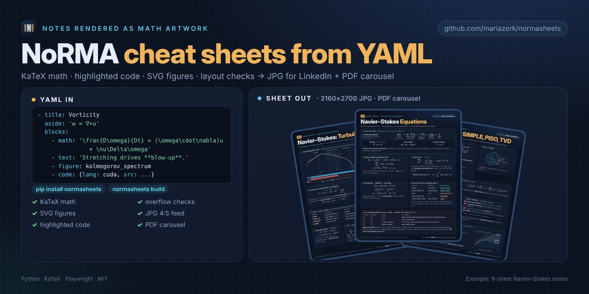
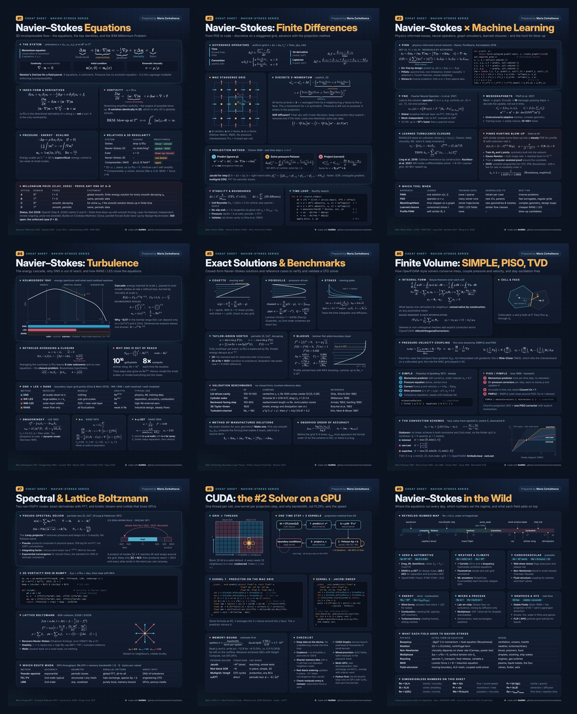

<p align="center">
  
</p>

<h1 align="center">NoRMA</h1>

<p align="center">
  <b>Notes Rendered as Math Artwork</b><br>
  Turn YAML into LinkedIn-ready cheat sheets with KaTeX formulas, highlighted code and SVG figures.<br>
  Exports 4:5 JPG for the feed and a PDF carousel, with automatic layout checks.
</p>

<p align="center">
  <a href="https://pypi.org/project/normasheets/"></a>
  
  <a href="https://github.com/mariazork/normasheets/actions/workflows/ci.yml"></a>
  <a href="https://github.com/mariazork/normasheets/blob/main/LICENSE"></a>
  
  
  <a href="https://github.com/mariazork/normasheets/stargazers"></a>
</p>

<p align="center">
  
</p>

> The name has three layers: the **norm** ‖·‖ of functional analysis, the Latin **norma** (a carpenter’s square, the ruler behind a clean grid), and Bellini’s opera **Norma**, because formulas deserve a stage.

## Why NoRMA

Technical cheat sheets and math infographics are usually made by hand in Figma, Canva or LaTeX, then fixed by eye every time a formula grows. NoRMA treats a cheat sheet as **code**:

- **Content in YAML, design in one theme.** A whole series looks consistent, and a new sheet is a new file.
- **Real typesetting.** KaTeX for formulas, Pygments for code, Inter for text: crisp at 2160×2700.
- **Figures are Python.** Plot a spectrum, integrate an ODE or draw a GPU pipeline, and the SVG lands in the card.
- **Layout checks, not eyeballing.** Overflowing formulas, cut code lines, wrapped table cells and footer collisions are reported in pixels, and `--strict` fails CI.
- **Made for LinkedIn.** 4:5 portrait JPG for the feed, plus all sheets merged into one PDF carousel for document posts.

Use it for ML and math cheat sheets, physics and engineering summaries, programming references, course notes or conference handouts.

## Gallery

The [`examples/navier-stokes`](https://github.com/mariazork/normasheets/tree/main/examples/navier-stokes) series: 9 sheets from the Millennium Prize problem to CUDA kernels, every one built from YAML.

<p align="center">
  
</p>

| # | Sheet | Shows off |
|---|---|---|
| 1 | [Equations](https://github.com/mariazork/normasheets/blob/main/docs/assets/gallery/01-equations.jpg) | labelled equations, status tags, footnotes |
| 2 | [Finite differences](https://github.com/mariazork/normasheets/blob/main/docs/assets/gallery/02-finite-differences.jpg) | MAC-grid figure, numbered tiles, NumPy code |
| 3 | [Machine learning](https://github.com/mariazork/normasheets/blob/main/docs/assets/gallery/03-ml.jpg) | PINN loss + PyTorch autograd code |
| 4 | [Turbulence](https://github.com/mariazork/normasheets/blob/main/docs/assets/gallery/04-turbulence.jpg) | Kolmogorov spectrum computed in `figures.py` |
| 5 | [Benchmarks](https://github.com/mariazork/normasheets/blob/main/docs/assets/gallery/05-benchmarks.jpg) | Blasius profile solved with RK4 |
| 6 | [Finite volume](https://github.com/mariazork/normasheets/blob/main/docs/assets/gallery/06-finite-volume.jpg) | Sweby diagram, OpenFOAM snippets |
| 7 | [Spectral & LBM](https://github.com/mariazork/normasheets/blob/main/docs/assets/gallery/07-spectral-lbm.jpg) | aliasing diagram, D2Q9 lattice |
| 8 | [CUDA](https://github.com/mariazork/normasheets/blob/main/docs/assets/gallery/08-cuda.jpg) | CUDA kernels, kernel pipeline figure |
| 9 | [Applications](https://github.com/mariazork/normasheets/blob/main/docs/assets/gallery/09-applications.jpg) | Reynolds-number map, key–value grid |

## How it works

```
YAML sheet ──► HTML (Jinja2 + theme CSS) ──► headless Chromium (Playwright)
                                              ├─ KaTeX renders math, fonts load
                                              ├─ layout checks (overflow, wraps, footer gap)
                                              ├─ screenshot ──► NN-name.jpg
                                              └─ print ──────► pdf/NN-name.pdf ──► series.pdf
```

## Install

```bash
pip install -e .                 # from this folder (after publishing: pip install normasheets)
playwright install chromium      # one-time browser download
```

One name everywhere: `normasheets` is the PyPI package, the command, the Python module and the repository. **NoRMA** is the project’s short name.

Fonts (Inter, DejaVu Sans Mono) and KaTeX are bundled, so output is identical on every machine.

## Quick start

```bash
normasheets init my-series --series "ML Basics" --author "Maria Zorkaltseva"
normasheets build my-series                      # all sheets -> my-series/out/
normasheets build my-series --only 2,3           # some sheets
normasheets build my-series/02-attention.yaml    # one file
normasheets build examples/navier-stokes --formats jpg,pdf,png --strict
normasheets blocks                               # list block types
```

`--strict` exits with code 1 when a layout check fails (useful in CI). Without it, files are still written so you can look at the problem.

## A series folder

```
my-series/
  series.yaml        # shared settings
  01-intro.yaml      # one file per sheet, built in filename order
  02-....yaml
  figures.py         # optional: custom SVG figures
  out/               # 01-intro.jpg, pdf/01-intro.pdf, series.pdf, html/ (for debugging)
```

### series.yaml

```yaml
series: Navier–Stokes series
author: Maria Zorkaltseva
kicker: "Cheat sheet · {series}"      # {series} {author} {number} are substituted
byline: "Prepared by **{author}**"
size: {width: 1080, height: 1350, scale: 2}   # CSS px; scale 2 -> 2160x2700 JPG
jpg_quality: 93
output: out
pdf: navier-stokes-series.pdf
pdf_mode: raster                       # raster (default): pages = exact JPG renders; vector: selectable text
lint: {forbid: ["—"]}                  # fail if these strings appear (here: no em dashes)
palette: {amber: "#ffb000"}            # optional colour overrides
macros: {"\\R": "\\mathbb{R}"}         # optional KaTeX macros
logo: assets/logo.svg                  # optional: your logo in every sheet header
credit: false                          # hide the small "made with NoRMA" footer credit (shown by default)
sheets: [01-a.yaml, 03-c.yaml]         # optional explicit order / subset
```

### A sheet

```yaml
number: 4                       # shown as the #4 badge
title: 'Navier–Stokes:'
accent: Turbulence              # second part of the title, in the accent colour
subtitle: The energy cascade and how RANS / LES close the equations
header_gap: 10                  # optional: tighten space under the header

rows:
  - title: Kolmogorov 1941      # a row with a single card can be written as the card itself
    aside: energy spectrum      # muted text after the title
    style: hero                 # hero | alert | (none)
    math_size: 1.0              # formula scale in this card (default 1.1)
    blocks: [...]

  - cols: [1.25, 1]             # relative widths (numbers = fr) or CSS sizes like "300px"
    align: start                # optional: start | center | stretch
    cards:
      - title: Reynolds averaging
        dot: green              # cyan | amber | rose | green | #hex
        dense: true             # smaller text for crowded cards
        plain_title: true       # keep title case (e.g. "k-ε")
        blocks: [...]
      - title: Why DNS is out of reach
        blocks: [...]
    # more cards than columns wrap onto new lines automatically (see sheet #9)

footer:
  left: 'Refs: Kolmogorov 1941 · Pope 2000'
  right: '#{number} · {series}'
```

## Blocks

Each block is a mapping with one type key. Shared options on any block: `size` (font scale), `align`, `mt` (margin-top in px).

| Block | Purpose | Example |
|---|---|---|
| `text` | paragraph with inline markup | `- text: '**Bold** and $x^2$ math'` |
| `label` | small uppercase sub-heading | `- label: Kolmogorov scales` |
| `math` | display formula(s) | `- math: '\nabla\cdot\mathbf{u}=0'` or a list |
| `equation` | formula with a label column | `{label: Momentum, sub: '3 equations', tex: '...'}` |
| `boxes` | row of labelled formula boxes | `[{label: '**Continuity**', tex: '...'}, ...]` |
| `named_math` | coloured name + formula rows | `[{name: minmod, color: '#2f9cc4', tex: '...'}]` |
| `bullets` | bullet list | list, or `{color: amber, items: [...]}` |
| `steps` | numbered steps | `{color: rose, items: [...]}` |
| `checklist` | ✓ list in columns | list, or `{columns: 2, items: [...]}` |
| `table` | table | `{head: [...], rows: [[...]], widths: [20%], compact: true, bold_first: true}` |
| `code` | highlighted code | `{lang: python, font: 11.4, src: \| ...}` (python, cuda, cpp, bash, …) |
| `chips` | small pills | `['Re 10⁶–10⁸', 'Ma 0.1–0.85']` |
| `stats` | big numbers | `[{value: '10^{16}', unit: grid points, caption: '...'}]` |
| `kvgrid` | key / meaning grid | `{columns: 3, key_width: 130, items: [[Re = UL/ν, inertia / viscosity]]}` |
| `figure` | SVG from `figures.py` | `{name: sweby, args: {...}, max_width: 300, caption: ...}` |
| `columns` | side-by-side block groups | `{widths: [1.2, 1], gap: 18, items: [[blocks], [blocks]]}` |
| `tiles` | numbered sub-cards | `[{title: Predict, color: cyan, blocks: [...]}]` |
| `spacer` | vertical space in px | `- spacer: 8` |
| `html` | raw HTML escape hatch | `- html: '<div>...</div>'` |

### Inline markup (text, table cells, titles, bullets…)

| Write | Get |
|---|---|
| `**bold**` | **bold** |
| `$\eta < 2/L$` | inline KaTeX |
| `` `code` `` | monospace |
| `Re_{x}`, `k^{-5/3}` | subscript, superscript |
| `[[ok: solved]]` `[[open: …]]` `[[bad: …]]` `[[info: …]]` | status tags |
| `[[swatch: #2f9cc4]]` | colour square (legend in tables) |
| `[[color: cyan \| text]]` | coloured text |
| `\$`, `\*` | literal `$`, `*` |
| line break inside the YAML string | `<br>` |

Greek letters keep their case inside UPPERCASE headers (η stays η, not H).

### YAML quoting: the one rule

Put anything with a backslash (LaTeX) in **single quotes**: `'\frac{a}{b}'`. In double quotes YAML eats escapes (`"\eta"` becomes ESC + `ta`). The build detects this and tells you. Inside single quotes write an apostrophe as `''` (`'Newton''s law'`).

## Custom figures

Any public function in the series' `figures.py` is a figure. It receives `args` and returns an SVG string. `normasheets.svg` has the theme colours and small primitives:

```python
from normasheets.svg import AMBER, INK, LINE2, arrow, circle, line, math_label, path, svg, text

def decay(rate=0.5):
    W, H = 300, 160
    pts = [(20 + i * 2.6, 140 - 120 * 2.718 ** (-rate * i / 20)) for i in range(100)]
    g = line(20, 140, 280, 140, LINE2) + path(pts, INK) + math_label(250, 30, "u", "0", AMBER)
    return svg(g, W, H)
```

```yaml
- figure: {name: decay, args: {rate: 0.8}, max_width: 300}
```

Helpers: `svg`, `text`, `math_label` (italic symbol + subscript), `line`, `arrow`, `path`, `rect`, `circle`, `hatch` (pattern for “modelled / discarded” areas), `pow10`, colours `INK MUTED FAINT LINE LINE2 CYAN AMBER ROSE GREEN`, and `CAT`: three categorical colours validated for colour-blind readers on the dark background.

`examples/navier-stokes/figures.py` has 13 real figures to copy from: a Kolmogorov spectrum computed from Pope’s model, a Blasius profile integrated with RK4, the MAC grid, a Sweby diagram, a CUDA kernel pipeline, a Reynolds-number map and more.

## Layout checks

Every build measures the rendered page:

| Check | Level |
|---|---|
| KaTeX parse error (formula shown in red) | error |
| formula, code line, table, figure wider than its card | error |
| content closer than `min_footer_gap` (10 px) to the footer | error |
| footer text does not fit on one line | error |
| `lint.forbid` strings, YAML-eaten backslashes | error |
| table cell, chip, card title wraps to a second line | warning |
| more than `max_free_space` (140 px) left empty at the bottom | warning |

```
[ ok ] #4 04-turbulence                 footer gap 81px
[FAIL] #6 06-finite-volume              footer gap 7px
        x code line overflows card 'PISO / PIMPLE' by 11px
        x content reaches the footer: gap 7px < 10px
[warn] #8 08-cuda                       footer gap 40px
        ! wraps in 'MEMORY-BOUND': "periodic box: p̂ = −b̂ / |k|²"
```

Typical fixes: lower the card’s `math_size`, a code block’s `font`, change `cols` ratios, shorten a cell, or set `header_gap`.

## Theme

`normasheets/themes/dark.css`. Override colours per series with `palette`, add CSS with `extra_css` (series or sheet), or point `theme:` to your own CSS file.

## Other formats

`size` is free: `{width: 1080, height: 1080}` for square posts, `{width: 1920, height: 1080}` for slides. The repository’s own social preview is built with NoRMA at 1280×640: see [`docs/brand`](https://github.com/mariazork/normasheets/tree/main/docs/brand) and run `normasheets build docs/brand --formats png`. A `logo:` path in `series.yaml` puts your logo in every sheet header. Each sheet carries a small “made with NoRMA” credit in the footer; keep it to support the project, or set `credit: false`.

## Built with NoRMA

Made a series? Open a pull request adding it here, or share it in Discussions.

- [Navier–Stokes series](https://github.com/mariazork/normasheets/tree/main/examples/navier-stokes) by Maria Zorkaltseva

## Citation

If NoRMA helps your teaching or research material, please cite it via [`CITATION.cff`](https://github.com/mariazork/normasheets/blob/main/CITATION.cff).

## Licences

Code: MIT. Bundled: KaTeX (MIT), Inter (SIL OFL 1.1), DejaVu Sans Mono (Bitstream Vera licence); licence files are in `normasheets/assets/`.
